<!-- header:begin: brand-repos 0.1.0, variant studio, files in docs/brand/; the project-page sync drops this block -->
<picture>
  <source media="(prefers-color-scheme: dark)" srcset="docs/brand/readme-header-dark.svg">
  <source media="(prefers-color-scheme: light)" srcset="docs/brand/readme-header-light.svg">
  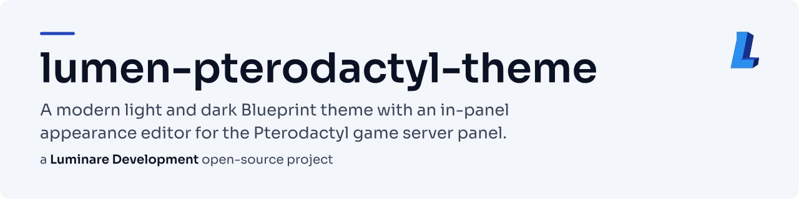
</picture>

<!-- byline:studio -->
*a [Luminare Development](https://luminare.tech/open-source/lumen-pterodactyl-theme/) open-source project*
<!-- /byline:studio -->
<!-- byline:personal
*by Paul Pasaurek · [project page](https://luminare.tech/open-source/lumen-pterodactyl-theme/)*
/byline:personal -->

<!-- header:end -->

# lumen-pterodactyl-theme

A modern light and dark theme for the [Pterodactyl](https://pterodactyl.io) game server panel,
for the client area and the admin area, packaged as a [Blueprint](https://blueprint.zip)
extension with a customizer in the admin panel that changes colours, fonts, spacing, layout and
logos without a rebuild.

[](https://github.com/luminare-dev/lumen-pterodactyl-theme/actions/workflows/ci.yml)
[](https://github.com/luminare-dev/lumen-pterodactyl-theme/actions/workflows/panel.yml)
[](LICENSE)

<!-- screenshots:begin -->
| Dark | Light |
|---|---|
| 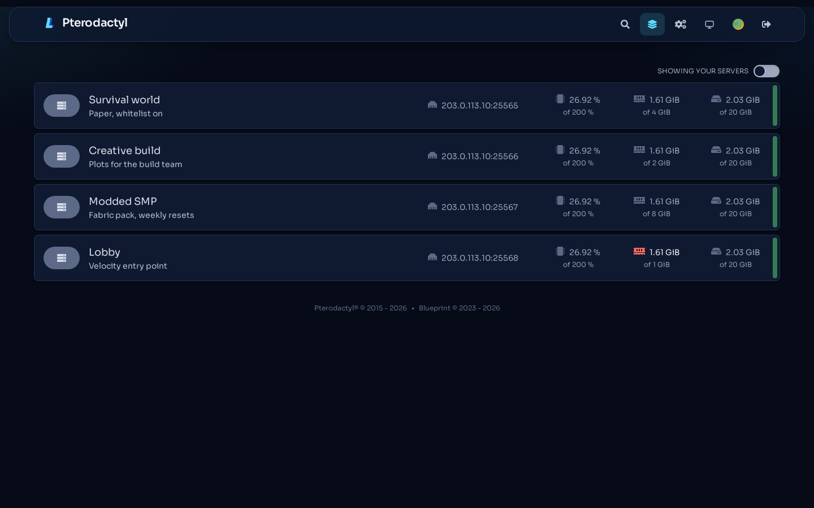 | 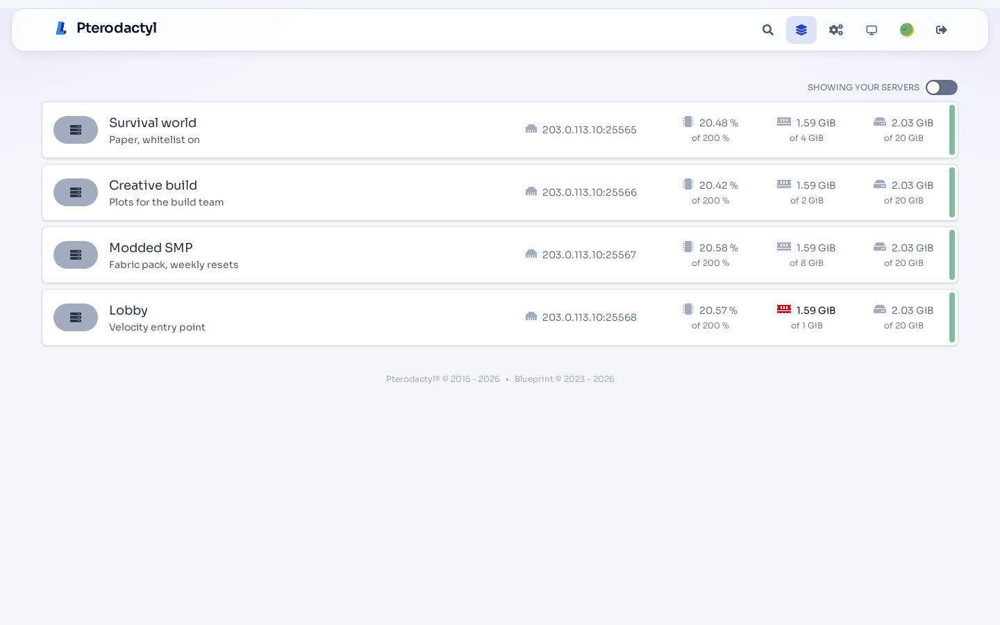 |
| 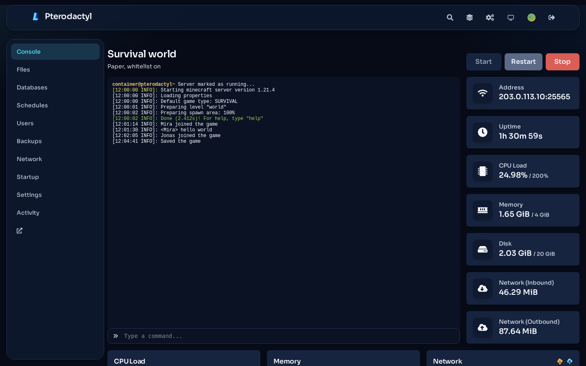 | 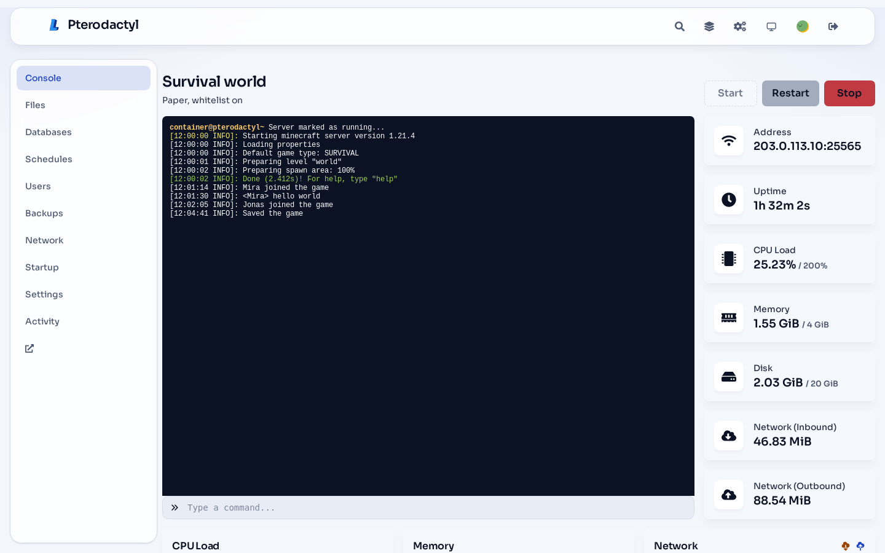 |
| 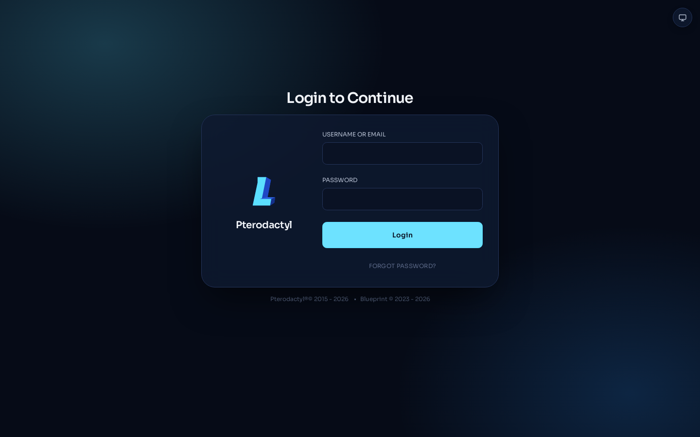 | 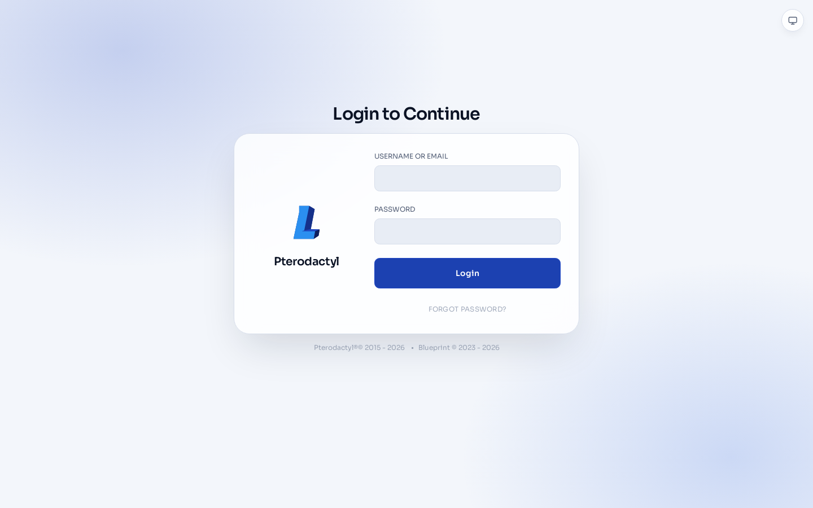 |
| 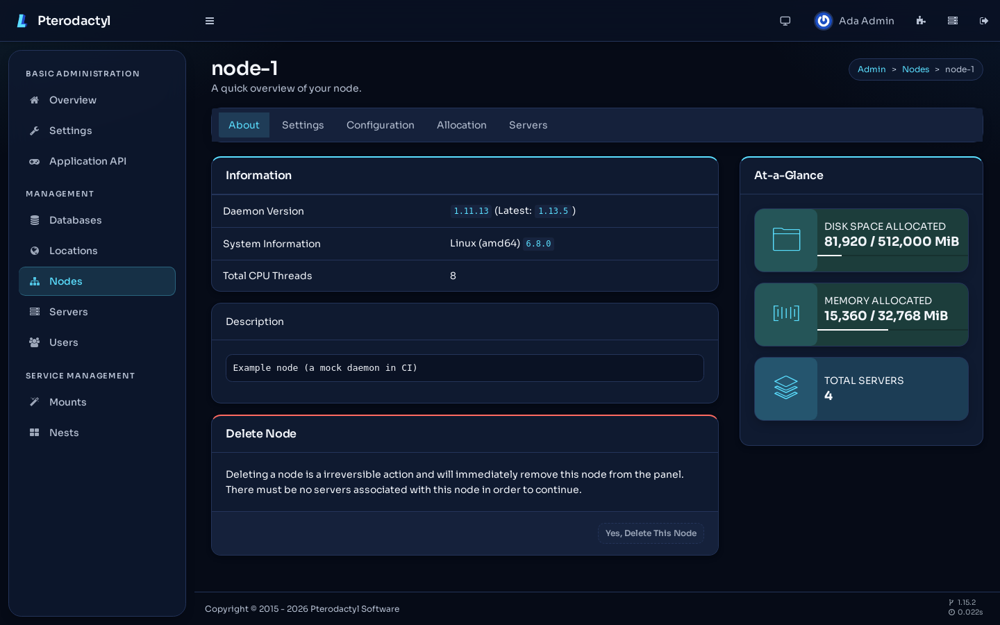 | 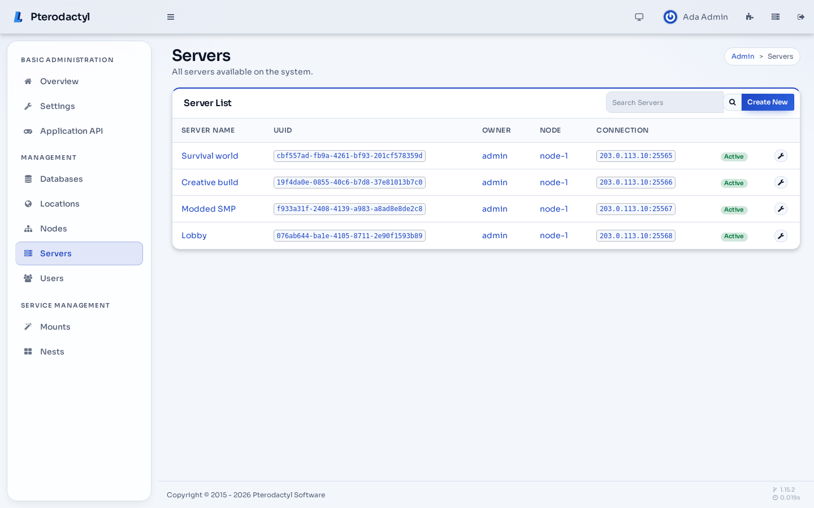 |
| 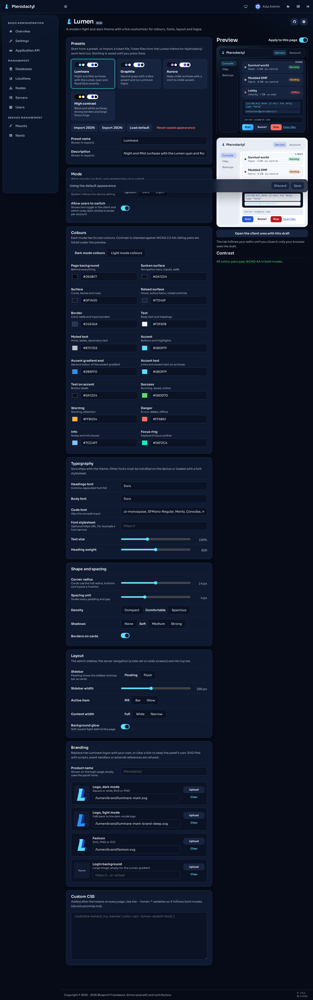 | 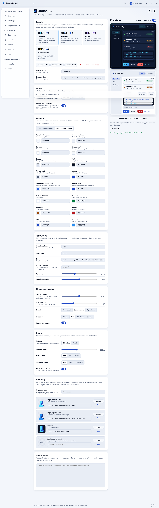 |
| 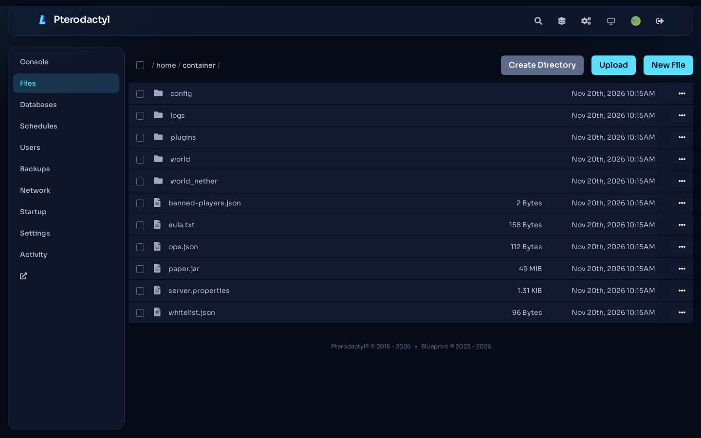 | 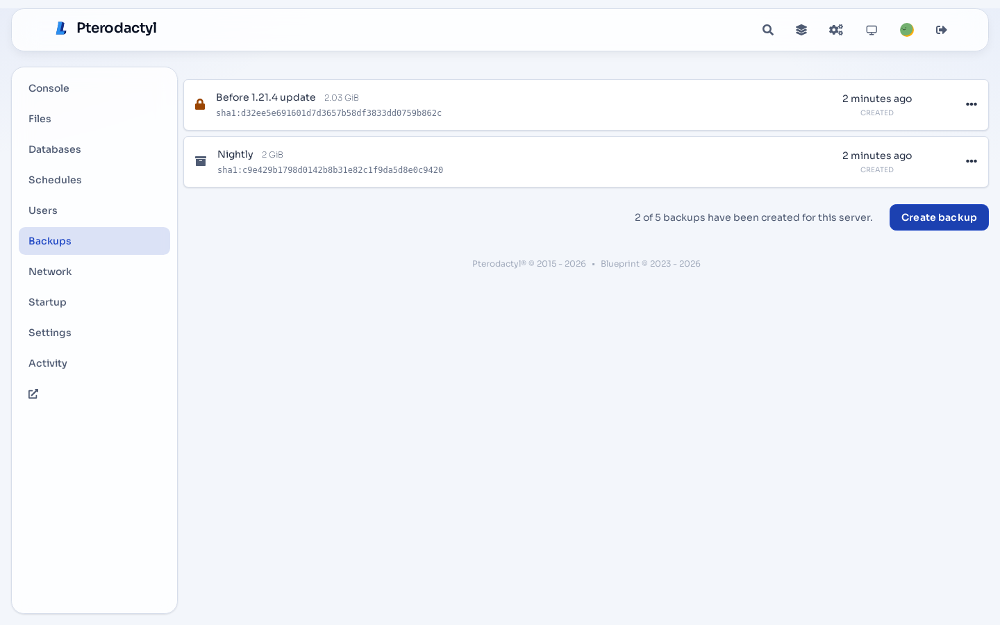 |
| 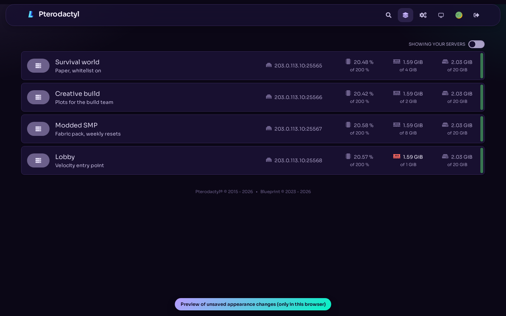 | 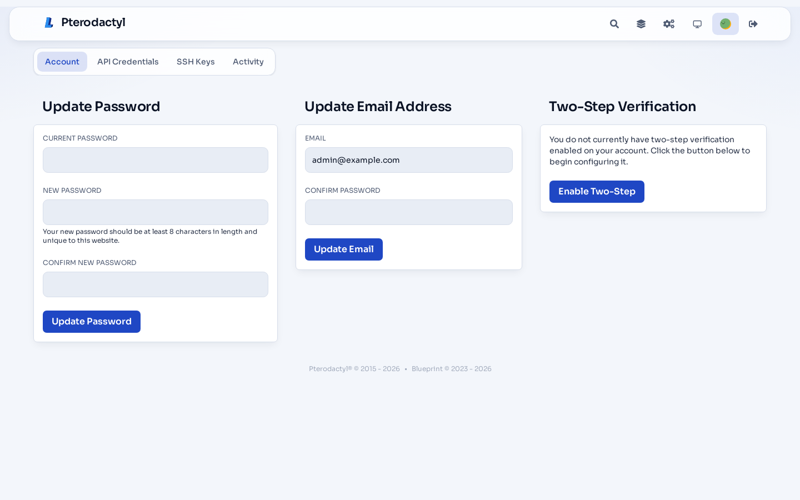 |

Screenshots from CI (the `screenshots` artifact of the `panel` workflow), with invented example
data and a mock daemon. The last dark image is the client area previewing an unsaved Aurora draft
from the customizer.
<!-- screenshots:end -->

## Why

Pterodactyl's own look is a fixed dark design. Lumen gives it a light and a dark mode, a modern
layout and a customizer, while staying a plain Blueprint extension: it adds its own files, ships
no copy of the panel's code and needs no frontend rebuild. The look is driven by a design-token
file stored in the database, the same format the Lumen theme for Hydrodactyl uses, so one exported
file styles both panels.

## Features

- Lumen look for the whole client area (dashboard, account, console, files, databases,
  schedules, users, backups, network, startup, settings), the login pages and the whole admin
  area (sidebar, header, boxes, tables, forms, tabs, modals, Blueprint pages).
- Dark and light mode, system default, a toggle in the client and admin area; the choice is
  saved per user account on the server. Admins can turn the toggle off.
- Admin → Extensions → Lumen: presets (Luminare, Graphite, Aurora, High contrast), JSON import and
  export compatible with the Hydrodactyl theme, live preview (the admin page, dark and light
  client samples, and the real client area in a tab with the unsaved draft), colour roles per mode
  with WCAG contrast warnings, fonts, text size, radius, spacing, density, shadows, sidebar and
  layout options, logo/favicon/login background uploads with safe SVG handling, custom CSS.
- Stored server-side and applied as CSS variables at runtime.
- Luminare branding by default, replaceable in the customizer.

## Quickstart

Back up the panel files and database first ([docs/install.md](docs/install.md)). With
Blueprint installed:

```bash
cd /var/www/pterodactyl
# lumen.blueprint from the latest release or the "lumen-blueprint" CI artifact
blueprint -install lumen
```

Then open **Admin → Extensions → Lumen**.

## How it works

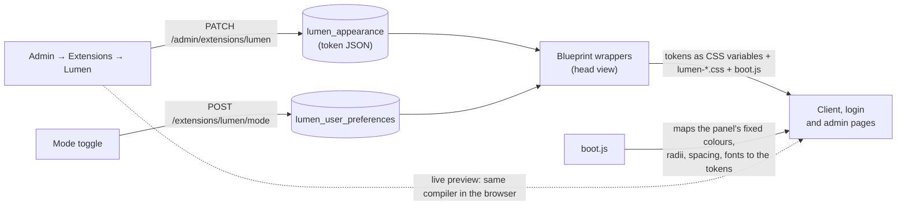

- `extension/` is the Blueprint extension (`conf.yml`, admin page and controller, wrappers, PHP
  classes, routes, migration, public files, presets). `scripts/build-js.mjs` and
  `scripts/build_blueprint.py` turn it into `lumen.blueprint`.
- The token schema and compiler are shared with the Hydrodactyl theme ([docs/tokens.md](docs/tokens.md)).
- The panel's React components write fixed colours; `boot.js` rewrites each style rule once as it
  is added, so the panel's palette, radii, spacing and fonts read the token variables. The admin
  area (AdminLTE) is restyled by `lumen-admin.css`.

## Supported versions

| Component | Tested with | Supported |
|---|---|---|
| Pterodactyl Panel | v1.15.2 (`90b2aa8`, image digest in `ci/versions.env`) | v1.15.x |
| Blueprint | beta-2026-08 (`00de3ba`, `release.zip` sha256 in `ci/versions.env`) | beta-2026-08 or newer |

CI builds the package, checks the shared code and the PHP/TypeScript parity, then boots the
pinned panel with Blueprint, MariaDB, Redis and a mock Wings daemon, installs the package with
`blueprint -install`, seeds example data and takes screenshots of both areas in both modes.

## Limitations

- Blueprint is required; there is no install path without it ([why](docs/install.md#supported-versions)).
- The console keeps a dark background in light mode, because the terminal draws light text.
- Colour mapping works on the panel's own palette; another extension that brings its own colours
  keeps them.
- The customizer is in English only.

## Documentation

- [Installing, updating and removing](docs/install.md)
- [Customizing](docs/customize.md)
- [Token schema](docs/tokens.md)
- [Contributing](https://github.com/luminare-dev/.github/blob/main/CONTRIBUTING.md) ·
  [Security](https://github.com/luminare-dev/.github/blob/main/SECURITY.md)

## Not affiliated

Not affiliated with or endorsed by the Pterodactyl project or the Blueprint project. Pterodactyl
and Blueprint are named only to describe what this project works with.

## Licence

[MIT](LICENSE), like Pterodactyl. The licence covers the code only: the project name, the
Luminare logos, header images and `docs/brand/` are not licensed (see [NOTICE](NOTICE)).

<!-- byline:studio -->
*a [Luminare Development](https://luminare.tech/open-source/lumen-pterodactyl-theme/) open-source project*
<!-- /byline:studio -->
<!-- byline:personal
*by Paul Pasaurek · [project page](https://luminare.tech/open-source/lumen-pterodactyl-theme/)*
/byline:personal -->
